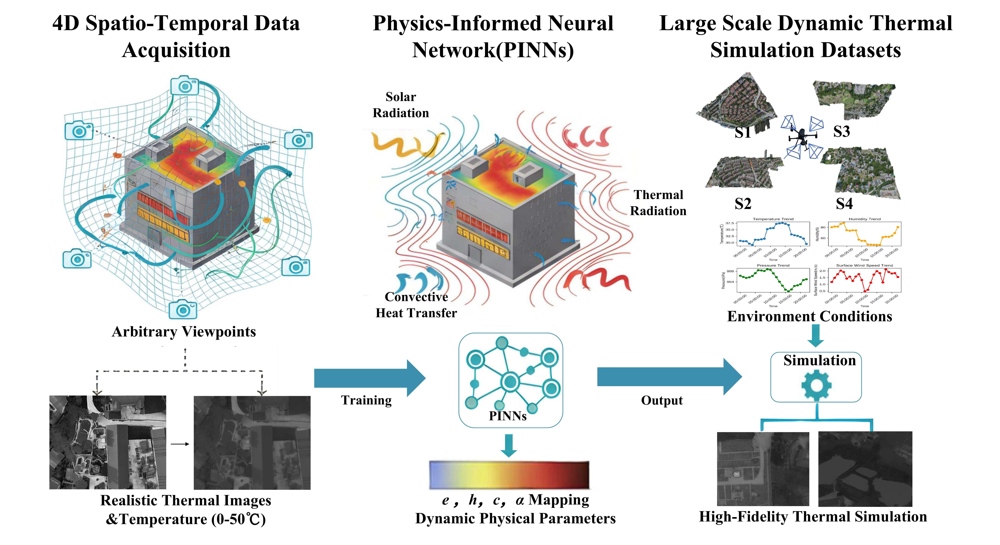

<p align="center">

  <h1 align="center"><a href="https://link.springer.com/chapter/10.1007/978-3-032-37429-5_18" target="_blank">ThermoGS:Decoupling Physical Surface Attributes for Spatio-Temporal Thermal Field Emulation via 4D Gaussian Splatting</h1>
  <p align="center">
    <a href="">Kun Yang*</a>,
    <a href="">Yuxiang Liu*</a>,
    <a href="">Zeyu Cui</a>,
    <a href="">Shen Yan</a>,
    <a href="">Maojun Zhang</a>,
    <a href="">Yu Liu</a>,
    <a href="">Xue Wang</a>,
    <a href="">Qing Wang</a>
    

  </p>
    <p align="center">
    *Corresponding authors

</p>

## Introduction
Thermal infrared imaging offers the advantage of all-weather capability, enabling non-intrusive measurement of an object's surface temperature. Consequently, thermal infrared images are employed to reconstruct 3D models that accurately reflect the temperature distribution of a scene, aiding in applications such as building monitoring and energy management. However, existing methods are limited to infrared reconstruction under specific scenarios and fixed environmental conditions, failing to adapt to diverse scenarios and dynamic environmental factors, while neglecting the temporal variation of temperature. To address this issue, we propose ThermoGS, a framework that integrates thermodynamics and 4D Gaussian Splatting. Building on thermodynamic principles, this framework incorporates physical interaction processes such as solar radiation, convective heat transfer, and thermal radiation. It further leverages Physics-Informed Neural Networks (PINNs) to perform physics-constrained learning on the framework, enabling 3D thermal simulation across different scenarios, environmental conditions, and time periods. Additionally, we deeply integrate physical theories with 4D Gaussian Splatting to predict physical quantities at real-world scales (e.g., emissivity, specific heat capacity, convective heat transfer coefficient, and absorptivity). We also introduce a large-scale dynamic dataset specifically designed for thermal imaging under diverse scenarios and environmental conditions. Extensive experiments and evaluations demonstrate that ThermoGS significantly outperforms comparative methods in thermal simulation, with a predicted temperature error within 1 degree Celsius.

<p align="center">
  <a href="">
    
  </a>
</p>
<p align="center">
  Our framework integrates thermodynamic principles with 4D Gaussian Splatting for physically-consistent thermal emulation under clear-sky conditions. By inputting scene geometry and environmental factors (e.g., solar radiation, wind speed), it simulates 4D spatiotemporal thermal fields and renders accurate temperature maps from arbitrary views. Notably, ThermoGS decouples intrinsic material attributes to ensure adherence to thermodynamic laws.
</p>
<br>

## Dataset
Download the [data](https://drive.google.com/drive/folders/1REtQB-jXvLgl9Nzj5fP1-951lYLZWAeb?usp=share_link) and put it to your dataset folder.

## Citation
If you find this repository useful in your project, please cite the following work:
```
@inproceedings{yang2026thermogs,
  title={ThermoGS: Decoupling Physical Surface Attributes for Spatio-Temporal Thermal Field Emulation via 4D Gaussian Splatting},
  author={Yang, Kun and Liu, Yuxiang and Cui, Zeyu and Yan, Shen and Zhang, Maojun and Liu, Yu and Wang, Xue and Wang, Qing},
  booktitle={European Conference on Computer Vision},
  pages={302--319},
  year={2026},
  organization={Springer}
}
```
